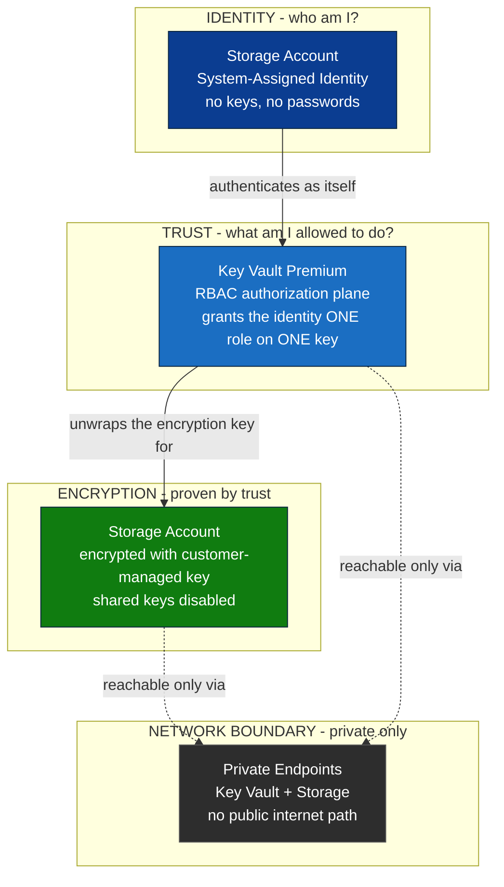

# Modular Azure Baseline: Hardened Identity-First Landing Zone

## Project Overview
A Technical Proof of Concept for a secure, automated Azure baseline, built with Infrastructure-as-Code. Moving beyond manual "Click-Ops," it orchestrates core platform components with a focus on identity-first authentication and Zero-Trust network principles.

The design is **statically verified** — every resource passes Checkov security analysis (30/30, zero failures) before any deployment. This is a *validated design*, hardened by default and built to be deployed repeatedly with strict configuration consistency.

---

## System Architecture

Identity proves who it is → trust grants one specific permission → encryption follows from that trust → and everything sits behind a private network boundary.



---

## Architecture Diagrams (Graphviz)

Detailed architecture diagrams live in [`/docs`](./docs/). Each answers one question:

| Diagram | Question |
|---------|----------|
| [Infrastructure](./docs/infrastructure.svg) | What Azure resources exist? |
| [Identity Flow](./docs/identity-flow.svg) | How does trust move through the system? |
| [Zero Trust](./docs/zero-trust.svg) | Where are the network boundaries? |
| [Dependency](./docs/dependency.svg) | In what order does Terraform build this? |

Diagrams are derived from Terraform source and verified against `main.tf`. Re-render with:
`dot -Tsvg docs/<name>.dot -o docs/<name>.svg`

---

## What This Deploys (verified)

### Identity-First Authentication
* **System-Assigned Managed Identity** on the storage account — no stored keys or passwords.
* **Entra ID authentication enforced** (`storage_use_azuread = true`) — Azure AD identity, not shared keys.
* **Shared Key authentication disabled** (`shared_access_key_enabled = false`) — eliminates leaked-connection-string risk.

### RBAC Authorization Plane
Key Vault authorization is delegated to **Azure RBAC**, not legacy Key Vault access policies (`rbac_authorization_enabled = true`).

This is a deliberate identity decision, not a refactor. Access policies are a bespoke, vault-local permission model. Azure RBAC is the *tenant-wide authorization plane* — the same role definitions, the same scope inheritance, PIM-eligible, and reviewable through Entra access reviews. Migrating the vault onto RBAC brings it under the same identity control plane as every other resource in the subscription.

Two role assignments, both scoped to the vault alone:

| Principal | Role | Why |
|---|---|---|
| Deploying principal | `Key Vault Crypto Officer` | Create and rotate the encryption key. Data plane. |
| Storage account's managed identity | `Key Vault Crypto Service Encryption User` | Wrap/unwrap only. It cannot read, create, or delete keys — it can only *use* the one it has been given. |

**Propagation note:** RBAC role assignments replicate asynchronously and more slowly than access policies. Key creation must declare `depends_on` the role assignment, or Terraform races the authorization plane and fails with a 403. This is eventual consistency in Azure's control plane, and it must be designed for.

### Customer-Managed Encryption
* **Azure Key Vault (Premium / HSM)** with purge protection and soft-delete.
* **RSA-HSM encryption key** with a set expiration date, encrypting storage via Customer-Managed Key (CMK).
* The storage identity holds wrap/unwrap rights on that key and nothing else — least privilege, expressed as a role, not a hand-curated permission list.

### Zero-Trust Networking — and where the boundary actually sits
* **Storage account:** public network access fully disabled. Data plane reachable only via **Private Endpoint** (`10.0.3.x`).
* **Key Vault:** **default-deny firewall** (`default_action = "Deny"`), with exactly one permitted IP — the deploying workstation.
* **Private Endpoints** for both vault and storage. The storage → vault key-unwrap path never traverses the public internet.
* **Network Security Group** with internal-only inbound rules, associated to the endpoints subnet.

#### Design note — two routes to the vault's data plane

An earlier iteration set `public_network_access_enabled = false` on the vault *and* declared an IP allowlist. That deployment failed:

```
Error: checking for presence of existing Key "storage-encryption-key"
StatusCode=403 Code="Forbidden"
Message="Public network access is disabled and request is not from a trusted
service nor via an approved private link."
InnerError={"code":"ForbiddenByConnection"}
```

The cause is non-obvious and worth stating plainly: **`public_network_access_enabled = false` overrides `network_acls` entirely.** The IP allowlist is never evaluated. The vault had been isolated so completely that the deploying principal could not reach its own data plane to create a key.

That is not a bug. It is the vault correctly refusing to trust anything that did not arrive over private link. But it forces a decision, because the two callers need different routes to the same data plane:

| Route | Actor | Path | Posture |
|---|---|---|---|
| **Workstation route** (data plane) | Terraform, deploying: creates and rotates the key | Public endpoint, default-deny firewall, single IP | Permitted by explicit allowlist |
| **Private route** (data plane) | Storage account, unwrapping the CMK | Private Endpoint | Never touches the internet |

Both routes are data plane: the firewall governs access to what is *inside* the vault (keys, secrets, certificates). It does not govern the control plane (creating or changing the vault resource itself), which is controlled by Azure RBAC.

The posture chosen here lets the deploying workstation in by IP for key creation and rotation, while the storage account's own key use stays on the private route. Checkov concurs that this is a locked-down vault: `CKV_AZURE_189` (*"Ensure that Azure Key Vault disables public network access"*) **passes**, because a default-deny firewall with a single allowlisted IP is not an open endpoint.

The production-correct alternative is a **VNet-integrated build agent**, which removes the allowlist — and the dynamic-IP dependency — entirely. See Roadmap.

### Verified by Static Analysis
* **30/30 Checkov security checks passing, zero failures** — covering encryption, network isolation, TLS, key management, shared-key suppression, private endpoints, and identity. Re-runnable with `checkov -d .`

---

## Roadmap (next iterations)
*Honestly scoped — designed for, not yet implemented in this repository:*

* **VNet-integrated build agent** — the deploying workstation is currently permitted through the Key Vault firewall by IP. This is a lab compromise. Production runs the deployment from inside the network boundary, removing the allowlist and the dynamic-IP dependency entirely.
* **Conditional Access** — automated MFA and device-compliance policies. *(Human identity control plane; this repository is workload identity.)*
* **Remote state backend** — Azure Blob Storage backend with state locking for team collaboration.
* **Queue properties refactor** — migrate to the `azurerm_storage_account_queue_properties` resource ahead of AzureRM v5.0.
* **CMK resource refactor** — migrate `key_vault_id` and `key_name` to updated argument syntax ahead of AzureRM v5.0.

---

## Technical Stack
* **Orchestration:** Terraform (HCL)
* **Cloud Provider:** Microsoft Azure
* **Authorization:** Azure RBAC
* **Security Scanning:** Checkov (Static Analysis Security Testing)
* **Automation:** PowerShell Core
* **Version Control:** Git / GitHub

---

## Deploy
```bash
terraform init
terraform validate
terraform plan
terraform apply
```
> Requires an authenticated Azure CLI session (`az login`) and Terraform ≥ 1.x.
>
> `terraform.tfvars` must supply `deployment_ip` — the public IP of the deploying workstation, permitted through the Key Vault firewall for key creation and rotation (data-plane operations). This file is gitignored.

---

## Repository Structure
```bash
.
├── docs/
│   ├── infrastructure.dot   # Physical resource graph (source)
│   ├── infrastructure.svg   # Physical resource graph (rendered)
│   ├── identity-flow.dot    # Identity & trust chain (source)
│   ├── identity-flow.svg    # Identity & trust chain (rendered)
│   ├── zero-trust.dot       # Network boundary flow (source)
│   ├── zero-trust.svg       # Network boundary flow (rendered)
│   ├── dependency.dot       # Terraform creation order (source)
│   └── dependency.svg       # Terraform creation order (rendered)
├── main.tf          # Primary orchestration logic (RG, Storage, VNET, Key Vault, RBAC, Endpoints)
├── providers.tf     # AzureRM provider + Entra identity data source
├── variables.tf     # Input declarations for environment abstraction
├── outputs.tf       # Exported resource metadata
├── .gitignore       # Excludes .tfstate, .tfvars, and secrets
└── README.md        # Project documentation
```