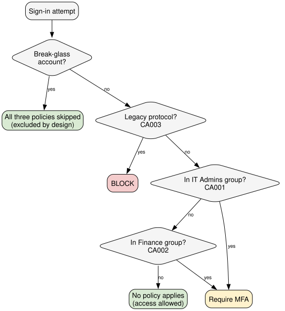

# P2 - Conditional Access as Code

Three Conditional Access policies built with Microsoft Graph PowerShell, run in report-only first and then enforced, with a break-glass account excluded from all of them. Built on 18 Nov 2026 in a lab tenant.

## What was built

| Policy | Targets | Control | Report-only | Enforced |
|---|---|---|---|---|
| CA001 - Require MFA - IT Admins | `lab-IT-Admins` group | Require MFA | 20:47 | 23:39 (portal) |
| CA002 - Require MFA - Finance | `lab- Finance-Users` group | Require MFA | 20:50 | 21:07 |
| CA003 - Block legacy authentication | All users | Block legacy protocols | 20:50 | 21:07 |

All three exclude the `lab-breakglass` account.

## Design decisions

- **Persona = group.** Policies target groups, not individuals, so adding a person to a group applies the policy to them.
- **Break-glass first.** A dedicated Global Admin account was created and tested before anything was enforced. It is permanent and not PIM-eligible on purpose: during an outage there is no time for an approval flow. Its sign-in showed Conditional Access: Not applied.
- **Security Defaults switched off first.** Security Defaults and Conditional Access cannot run together, so it was disabled (evidence 01, 02).
- **Report-only before enforcement.** Each policy logged what it would have done before it was allowed to block anyone.
- **Legacy auth blocked.** Old protocols can't perform MFA, so they bypass it.

## Evidence

| # | File | Shows |
|---|---|---|
| 01 | `01-security-defaults-on.png` | Security Defaults enabled (before) |
| 02 | `02-security-defaults-off.png` | Security Defaults disabled |
| 03 | `03-policies-report-only.png` | All three policies in Report-only |
| 04 | `04-signin-report-only.png` | Report-only results for a Finance user's sign-in |
| 05 | `05-signin-enforced-ca-tab.png` | CA002 applied to a Finance user: Success |
| 06 | `06-signin-enforced-auth-details.png` | MFA requirement "Previously satisfied" |
| 07 | `07-all-policies-enforced.png` | All three policies On |
| 09 | `09-audit-log-policy-changes.png` | Add and update events for every policy |
| 10 | `10-audit-log-mfa-registration.png` | Authenticator registration during a Finance user's first sign-in |

There is no evidence 08: a planned screenshot of the MFA challenge was not captured.

## What the logs showed

- **Report-only:** for the Finance test user, CA002 showed "User action req..." (truncated in the screenshot), CA001 showed Not applied (he is not an IT admin), and CA003 was not applied to a modern sign-in.
- **Enforced:** CA002 applied and showed Success, with the authentication method "Previously satisfied", meaning an MFA claim was already present.
- **MFA registration:** the audit log shows an Authenticator registration at the time of a second Finance user's first sign-in (10). The log does not say whether CA002 or the self-service password reset flow forced it, so I do not claim CA002 caused it.

## Limitations and notes

- The Entra ID P2 trial ended at 00:00 on 19 Nov 2026, so this lab was built inside a licence window. Conditional Access needs at least Entra ID P1.
- No deliberate-failure test was captured (a user visibly stopped at an MFA wall).
- CA001 was promoted to enforced in the portal, not by script, because a Microsoft Graph PowerShell module version conflict blocked the terminal. The change is recorded in the audit log (09).
- One group name contains a stray space (`lab- Finance-Users`), so the scripts look it up by exact name.

## Run order

```powershell
Connect-MgGraph -Scopes "Policy.Read.All","Policy.ReadWrite.ConditionalAccess","Directory.Read.All","User.Read.All"
.\scripts\01-ca001-admins-mfa.ps1
.\scripts\02-ca002-ca003-finance-legacy.ps1
.\scripts\03-promote-to-enforced.ps1 -Names "CA003","CA002","CA001"
```
## Decision flow



Decision record: [docs/adr-p2-conditional-access.md](../docs/adr-p2-conditional-access.md)
