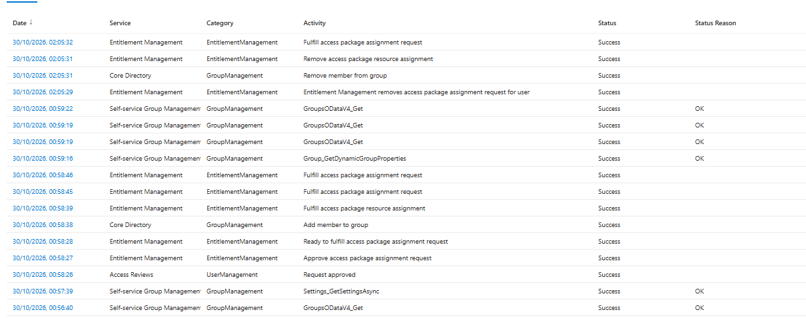

# Entra Entitlement Management: Time-Limited, Approved Contractor Access

**Lab P6** | Microsoft Entra ID P2 | Entitlement management (access packages)

A contractor requests access, a named approver signs it off, access is delivered, and it is removed automatically one hour later. No one adds the user to the group by hand at any point.

---

## What this proves

| Claim | Evidence |
|---|---|
| The user had no access before approval | [`01-group-before.png`](evidence/01-group-before.png) |
| Only the named user can request the package | [`02a-requests-policy-requester.png`](evidence/02a-requests-policy-requester.png) |
| A separate named approver must approve, with justification | [`02b-requests-policy-approver.png`](evidence/02b-requests-policy-approver.png), [`05-request-approved.png`](evidence/05-request-approved.png) |
| Access is time-limited and cannot be extended or lengthened by the requester | [`03-lifecycle-policy.png`](evidence/03-lifecycle-policy.png) |
| Access arrived through the package, not a manual add | [`06-group-after.png`](evidence/06-group-after.png), [`09-audit-log.png`](evidence/09-audit-log.png) |
| Access expired and was removed automatically | [`08-assignment-expired.png`](evidence/08-assignment-expired.png), [`09-audit-log.png`](evidence/09-audit-log.png), [`10-group-final.png`](evidence/10-group-final.png) |

---

## Design

| Component | Choice | Reason |
|---|---|---|
| Resource | Security group `Contractor-InternalTool-Access`, no members at creation, owner `lab-it.admin` | Stand-in for "access to an internal tool". Membership is controlled only by the package. |
| Package | `Contractor Internal Tool Access`, General catalog, group added with the **Member** role | One bundle: what is granted, who can ask, who approves, when it ends. |
| Who can request | Specific user `lab-a.brown` only (Self) | Least privilege. "All members" would let anyone in the tenant ask. |
| Approval | One stage, single named approver `lab-it.admin`, justification required from both requester and approver | The requester cannot approve their own request. |
| Lifecycle | Expires after **1 hour**, custom timeline **No**, extensions **No** | A short window makes expiry observable in one sitting. |
| Access reviews | Not enabled | Out of scope for this lab. |

Production note: a real contractor package would run for weeks, not an hour. The 1-hour setting is a lab choice to make expiry provable.

---

## Run

Times are 30 Oct 2026, GMT, taken from the audit log.

| Time | Event |
|---|---|
| 00:24 | `lab-a.brown` requests the package (status: Pending approval) |
| 00:58:26 | Request approved by `lab-it.admin` |
| 00:58:27 | Assignment approved. **The 1-hour clock starts here.** |
| 00:58:38 | Add member to group |
| 00:58:45 to 00:58:46 | Assignment fulfilled (status: Delivered) |
| 01:58:27 | Assignment end date reached |
| 02:05:29 | Entitlement management removes the assignment |
| 02:05:31 | Remove member from group |
| 02:05:32 | Removal fulfilled. Group is back to 0 members. |

---

## Findings

1. **Expiry counts from approval, not from delivery.** The end date (01:58:27) is exactly one hour after the approval event (00:58:27), not after the user landed in the group (00:58:38).
2. **Removal is not to the second.** The member was removed at 02:05:31, about 7 minutes after the 01:58:27 end date. Expiry is processed by a background job, so treat the limit as "around the hour". Any design that depends on exact cut-off times needs a different control.
3. **The requester-as-approver risk is easy to create.** While building the policy, the approver was first picked as a group, then as the requester themselves, because both appear in the search results. Catching it in review is why the final policy names a single approver, and why the review step belongs in the process.

---

## Not covered

- No deliberate-failure test was run. A second user (not named on the policy) was not tested for whether the package is hidden from them. The policy scope says it should be, but this lab does not prove it.
- No access review was attached to the package.
- Approval used a single approver and a single stage. No escalation or alternate approver was configured.
- The lab used the Microsoft Entra ID P2 trial licence. Some entitlement management features (lifecycle workflows, custom extensions, verified ID) need the separate Entra ID Governance licence and are not used here.

---

## Evidence

| File | Shows |
|---|---|
| [`01-group-before.png`](evidence/01-group-before.png) | Group with 0 members before approval |
| [`02a-requests-policy-requester.png`](evidence/02a-requests-policy-requester.png) | Requests tab: `lab-a.brown` only, Self ticked |
| [`02b-requests-policy-approver.png`](evidence/02b-requests-policy-approver.png) | Approver `lab-it.admin`, justification required, 14-day decision window |
| [`03-lifecycle-policy.png`](evidence/03-lifecycle-policy.png) | Lifecycle: 1 hour, no custom timeline, no extensions |
| [`04-request-pending.png`](evidence/04-request-pending.png) | Requester's history showing Pending approval |
| [`05-request-approved.png`](evidence/05-request-approved.png) | Approvals page showing the request as Approved |
| [`06-group-after.png`](evidence/06-group-after.png) | Group with `lab-a.brown` as the single member |
| [`07-assignment-delivered.png`](evidence/07-assignment-delivered.png) | Assignment Delivered, end date 01:58:27 |
| [`08-assignment-expired.png`](evidence/08-assignment-expired.png) | Same assignment, status Expired |
| [`09-audit-log.png`](evidence/09-audit-log.png) | Full audit timeline from request to removal |
| [`10-group-final.png`](evidence/10-group-final.png) | Group back to 0 members |

---

## Skills shown

Entra entitlement management, access packages and policies, approval workflows, least-privilege request scoping, time-bound access, audit log reading, and writing up what a control does and does not guarantee.
